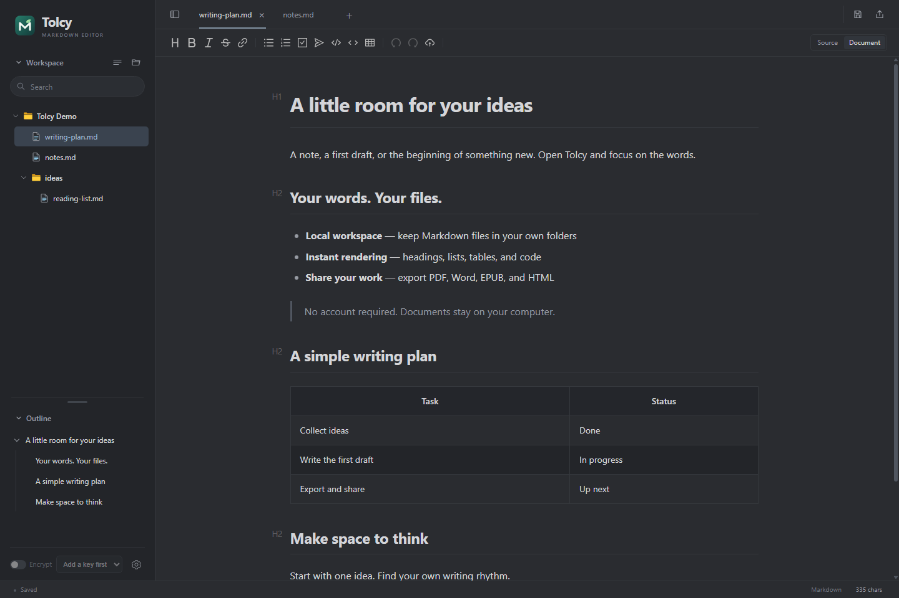
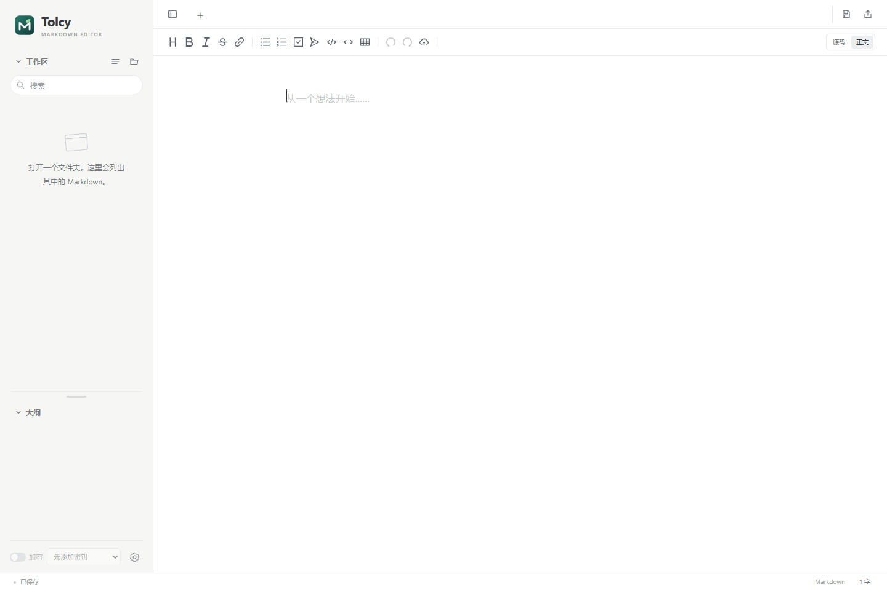
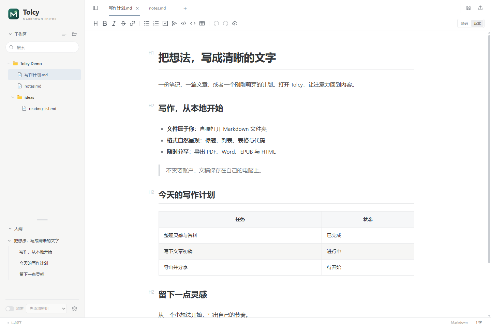
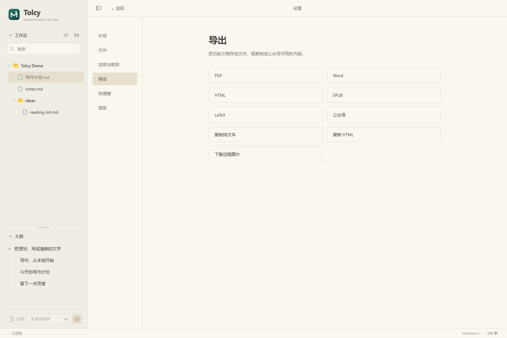
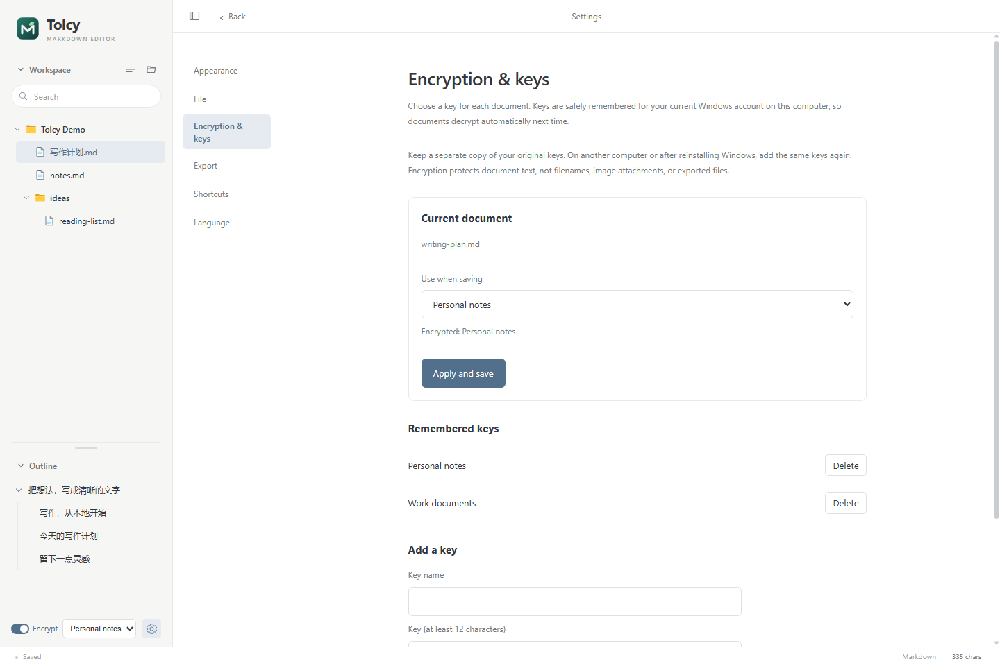

# Tolcy Markdown

**Local files. A little room to write.**

A free, open-source Markdown desktop editor for Windows with instant rendering, local workspaces, multiple tabs, per-document encryption, and document export. No account required. Save your writing directly in your own folders.

[简体中文](README.md) · [Download (Gitee)](https://gitee.com/tolcy/markdown/releases/latest) · [GitHub](https://github.com/tolcy/markdown/releases/latest) · [Release notes](RELEASE_NOTES.md) · [MIT license](LICENSE)



## Download

1. Open [Gitee Releases](https://gitee.com/tolcy/markdown/releases/latest) or [GitHub Releases](https://github.com/tolcy/markdown/releases/latest) and download `TolcyMarkdown_0.1.0_x64-setup.exe`.
2. Run the installer and launch Tolcy.
3. Open a Markdown file or a local folder and start writing.

For Windows 10 / 11 x64. Microsoft WebView2 is required; PDF export also requires Microsoft Edge. The installer adds Tolcy to “Open with” for `.md`, `.markdown`, and `.txt` without taking over the default application.

**You do not need Node.js or Rust to use the installer.** Source code lives in this repository; downloadable installers live in Releases.

## Open and start writing

- Start with an empty editor, without a sample article or an automatically created tab.
- Type to begin a document, or open an existing file. Work with folders and multiple tabs.
- Close untouched empty drafts immediately; documents with unsaved content prompt you to save.
- Save a document into an open workspace and its file list updates automatically.



## Features

| Writing and reading | Files and sharing |
| --- | --- |
| Instant Markdown rendering and source mode | Local workspace tree and multiple tabs |
| Headings, lists, quotes, tables, code, and math | File search, quick open, and workspace find/replace |
| Outline navigation, word counts, and shortcuts | Export PDF, Word (DOCX), EPUB, HTML, and LaTeX |
| Light, paper, and dark themes | Copy plain text, HTML, or WeChat-ready formatting |
| Focus mode, typewriter mode, and system spellcheck | Insert images and download remote images locally |
| Chinese, English, and other interface languages | Ctrl-click document links and web links |
| Choose an encryption key for each document | Multiple remembered keys and automatic decryption |





Screenshots render the actual project frontend with sample documents, without the Windows title bar.

## Document encryption

In **Settings → Encryption & keys**, add a name and a key of at least 12 characters. Add multiple keys, choose one for the current document, and select **Apply and save**. To return to plain Markdown, select **No encryption** and save.

The bottom-left sidebar also has an encryption switch and key selector beside Settings. Press `Ctrl+S` after changing them to apply the choice. They stay in sync with Settings and reflect the active document.

Encrypted files can retain the `.md` extension but store authenticated ciphertext. Tolcy recognizes them and decrypts them using a local key vault protected by your Windows account. Keys are not stored inside documents or normal browser preferences.

**Back up your original keys separately.** After moving computers or reinstalling Windows, add the same keys again. Missing or incorrect keys and damaged files produce an error instead of loading unreadable content or automatically overwriting the file. Filenames, image attachments, exports, and copied content are not protected by document encryption.

The format uses AES-256-GCM and Argon2id. It protects stored text; another implementation with the correct key can also decrypt it. See [docs/ENCRYPTION.md](docs/ENCRYPTION.md).

### What encryption protects

| Situation | Current behavior |
| --- | --- |
| Someone only has the encrypted file, even with another Tolcy installation | The correct key is still required. `keyId`, `salt`, and `nonce` are not secret keys |
| Someone has the correct key | They can decrypt the document. Do not share keys alongside encrypted files |
| Someone can use your signed-in Windows account | Remembered keys unlock automatically, so they may read documents. There is no application startup password lock |

Use long, hard-to-guess original keys. This implementation has not received an independent security audit.



## Shortcuts

| Shortcut | Action |
| --- | --- |
| `Ctrl+S` | Save |
| `Ctrl+B` / `Ctrl+I` / `Ctrl+D` | Bold / italic / strikethrough |
| `Ctrl+1`…`Ctrl+6` | Heading levels 1–6 |
| `Ctrl+F` / `Ctrl+Shift+H` | Find / replace |
| `Ctrl+P` | Quick open by file name |
| `Ctrl+H` | Jump to a heading |
| `Ctrl` + click | Open a link |

See **Settings → Shortcuts** for the full list. Empty new documents close immediately; documents with unsaved content prompt you to save.

## Local files and network access

Tolcy has no account requirement or built-in cloud document synchronization. You choose where Markdown files live and how to back them up.

Local storage does not mean every feature is offline. Remote images, some diagram rendering such as PlantUML, and explicitly downloading remote images may contact third-party services. Those services may receive the corresponding requests or diagram text. Export fidelity varies with complex formatting; review exported documents before sharing them.

## Development

Prerequisites: Node.js 20+, Rust 1.90+, Windows C++ build tools, and WebView2.

```sh
npm ci
npm test
npm run desktop
```

Build the Windows installer:

```sh
npm run desktop:build
```

Output: `src-tauri/target/release/bundle/nsis/Tolcy Markdown_0.1.0_x64-setup.exe`. `npm start` serves a browser preview; use the desktop app for full native file and export support.

## Feedback and contributions

Issues and contributions are welcome. Include your Windows version, Tolcy version, reproduction steps, and a sample without personal information in bug reports. Do not upload private documents, original encryption keys, or key-vault files. Run `npm test` before submitting changes.

## AI assistance and rights enquiries

This project includes AI-generated or AI-assisted code and documentation. Third-party components retain their own copyright and licenses.

**Rights enquiries: to_lcy@126.com**. See [AI_NOTICE.md](AI_NOTICE.md).

## License and acknowledgements

Tolcy's own code is licensed under [MIT](LICENSE). Built with [Tauri](https://github.com/tauri-apps/tauri), [Vditor](https://github.com/Vanessa219/vditor), and other open-source projects.

Third-party software, diagram engines, and fonts retain their respective licenses. See [THIRD_PARTY_NOTICES.md](THIRD_PARTY_NOTICES.md) and [licenses/](licenses/) for notices, upstream source links, and license texts.
