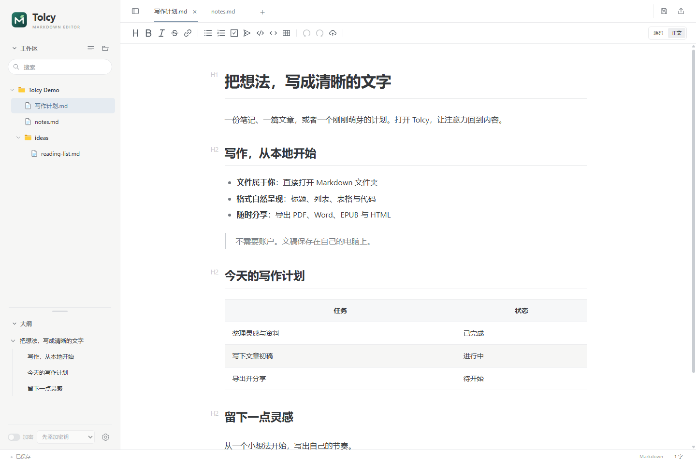
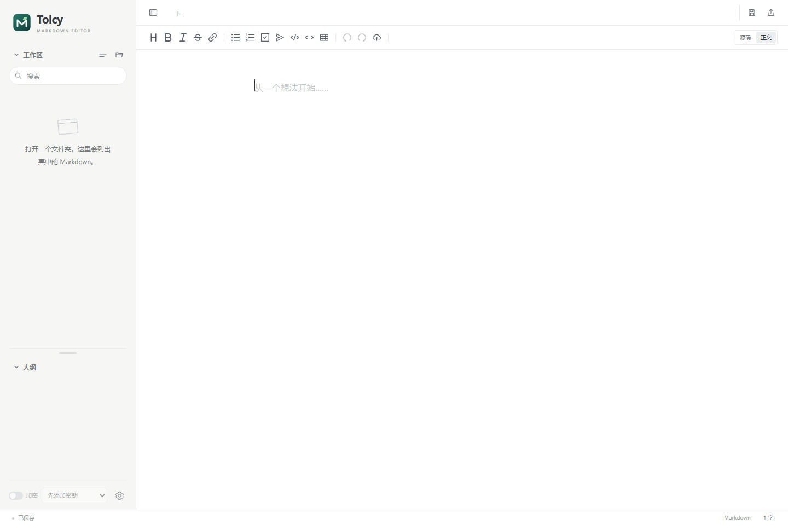
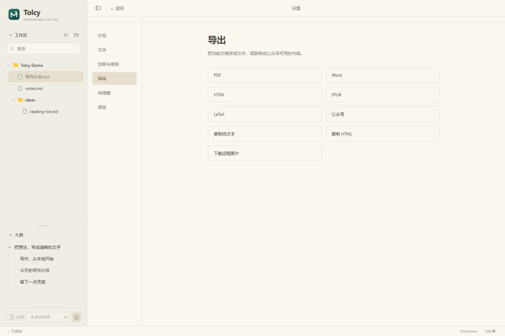
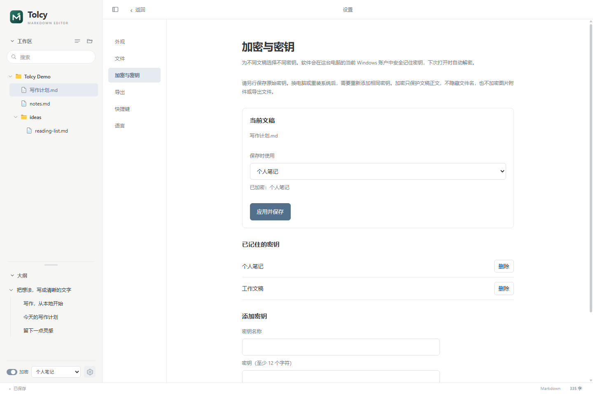

# Tolcy Markdown

**让文字回到本地，让注意力回到写作。**

免费开源的 Windows Markdown 编辑器，支持即时渲染、本地工作区、多标签、按文稿加密和多种格式导出。无需账户，文稿直接保存在自己的文件夹里。

[English](README.en.md) · [下载安装包](https://gitee.com/tolcy/markdown/releases/latest) · [GitHub Releases](https://github.com/tolcy/markdown/releases/latest) · [更新说明](RELEASE_NOTES.md) · [MIT 许可证](LICENSE)



## 下载与安装

1. 在 [Gitee Releases](https://gitee.com/tolcy/markdown/releases/latest) 或 [GitHub Releases](https://github.com/tolcy/markdown/releases/latest) 下载 `TolcyMarkdown_0.1.0_x64-setup.exe`。
2. 运行安装程序，启动 Tolcy。
3. 打开 Markdown 文件或本地文件夹，开始写作。

适用于 Windows 10 / 11 x64，运行需要 Microsoft WebView2；PDF 导出还需要 Microsoft Edge。安装程序把 Tolcy 加入 `.md`、`.markdown`、`.txt` 的“打开方式”，不会主动替换系统默认应用。

**普通用户只需下载安装包，无需安装 Node.js 或 Rust。** 源码在仓库中公开，安装包单独放在 Releases 中。

## 打开就能写

- 启动后是空白编辑区，不自动填入示例文章，也不自动新建标签。
- 可以直接输入开始写作，或打开已有文稿；支持工作区和多个编辑标签。
- 新建空白文稿未输入内容时，点 × 直接关闭；有未保存内容时再提醒保存。
- 文稿保存到已打开的工作区后，左侧文件列表会自动刷新。



## 功能

| 写作与阅读 | 文件与分享 |
| --- | --- |
| Markdown 即时渲染与源码切换 | 本地工作区文件树、多标签编辑 |
| 标题、列表、引用、表格、代码与公式 | 文件搜索、快速打开、工作区查找替换 |
| 大纲导航、字数统计和常用快捷键 | PDF、Word（DOCX）、EPUB、HTML、LaTeX 导出 |
| 浅色、纸色、暗色主题 | 复制纯文本、HTML 和公众号排版 |
| 专注模式、打字机模式、系统拼写检查 | 插入图片、下载远程图片到文稿旁 |
| 中英文及其他界面语言 | Ctrl + 点击打开文稿链接或网页链接 |
| 按文稿选择加密密钥 | 多密钥管理、重启后自动解密 |




截图使用示例文档在项目真实前端中生成，展示编辑区域，不包含 Windows 窗口标题栏。

## 文稿加密

在“设置 → 加密与密钥”添加名称和至少 12 个字符的密钥。可以添加多个密钥，为当前文稿选择一个，点击“应用并保存”。选择“不加密”再保存，可恢复普通 Markdown。

也可以直接使用左下角、设置按钮旁的加密开关与密钥选项。切换后按 `Ctrl+S` 保存生效；它们与设置页同步，并随当前文稿切换。

加密后的文件仍可保留 `.md` 扩展名，但磁盘上只存放带认证的密文。Tolcy 自动识别文件，并使用 Windows 账户保护的本地密钥库解密；密钥不会写入文稿或普通浏览器设置。

**请单独备份原始密钥。** 换电脑或重装系统后，重新添加相同密钥即可打开文稿。缺少密钥、密钥错误或文件损坏时会报错，不会把乱码加载进编辑器或自动覆盖原文件。文件名、图片附件、导出和复制的内容不受文稿加密保护。

文件加密使用 AES-256-GCM 与 Argon2id。它保护存储中的正文，并不阻止持有正确密钥且实现该公开格式的其他程序解密。格式说明见 [docs/ENCRYPTION.md](docs/ENCRYPTION.md)。

### 加密能保护什么

| 情况 | 当前行为 |
| --- | --- |
| 别人只有加密文件，或另外安装了 Tolcy | 仍需正确密钥才能读取正文；`keyId`、`salt`、`nonce` 不是密钥 |
| 别人拿到了正确密钥 | 可以解密；请勿把密钥与加密文件一起分享 |
| 别人能使用你已登录的 Windows 账户 | 本地密钥会自动解锁，可能直接读到正文；当前没有软件启动密码锁 |

请使用足够长、难以猜测的原始密钥。当前实现尚未经过独立安全审计。



## 常用快捷键

| 快捷键 | 操作 |
| --- | --- |
| `Ctrl+S` | 保存 |
| `Ctrl+B` / `Ctrl+I` / `Ctrl+D` | 加粗 / 斜体 / 删除线 |
| `Ctrl+1`…`Ctrl+6` | 一至六级标题 |
| `Ctrl+F` / `Ctrl+Shift+H` | 查找 / 替换 |
| `Ctrl+P` | 按文件名快速打开 |
| `Ctrl+H` | 跳转到标题 |
| `Ctrl` + 点击 | 打开链接 |

完整列表见“设置 → 快捷键”。新建且未输入内容的空白文档可直接关闭；有未保存内容时会提示保存。

## 本地文件与网络

Tolcy 不需要登录，没有内置的云端文稿同步。你可以使用自己的文件夹和备份方式管理 Markdown 文件。

本地保存不等于完全不联网：文稿中的远程图片、部分图表渲染（如 PlantUML）及主动下载远程图片可能访问第三方服务；这些服务可能接收对应资源请求或图表内容。复杂排版的导出保真程度可能不同，分享前请检查导出结果。

## 从源码开发

需要 Node.js 20+、Rust 1.90+、Windows C++ 构建工具与 WebView2。

```sh
npm ci
npm test
npm run desktop
```

打包 Windows 安装程序：

```sh
npm run desktop:build
```

输出：`src-tauri/target/release/bundle/nsis/Tolcy Markdown_0.1.0_x64-setup.exe`。`npm start` 仅启动浏览器预览，完整文件系统与原生导出功能请使用桌面版。

```text
public/       编辑界面、主题、界面翻译
src-tauri/    Rust 桌面功能与 Windows 安装程序配置
scripts/      前端打包与回归测试
docs/        截图和发布说明
licenses/     第三方许可证与版权声明
```

## 反馈与贡献

欢迎通过 Issues 报告问题或提出建议。反馈时请说明 Windows 版本、Tolcy 版本、复现步骤，以及不含个人内容的示例文稿。不要上传私人文稿、原始密钥或密钥库文件。提交改动前请运行 `npm test`。

## AI 辅助生成与版权反馈

本项目包含 AI 生成或辅助编写的代码与说明文档。第三方组件保留各自版权和许可证。

**版权反馈邮箱：to_lcy@126.com**。详细说明见 [AI_NOTICE.md](AI_NOTICE.md)。

## 许可证与致谢

Tolcy 自有代码使用 [MIT](LICENSE) 许可证。感谢 [Tauri](https://github.com/tauri-apps/tauri)、[Vditor](https://github.com/Vanessa219/vditor) 以及其他开源项目。

第三方代码、图表引擎和字体保留各自许可证，不因本项目使用 MIT 而变更。详细声明与组件源码链接见 [THIRD_PARTY_NOTICES.md](THIRD_PARTY_NOTICES.md) 和 [licenses/](licenses/)。
